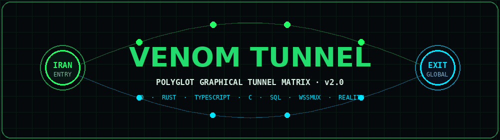
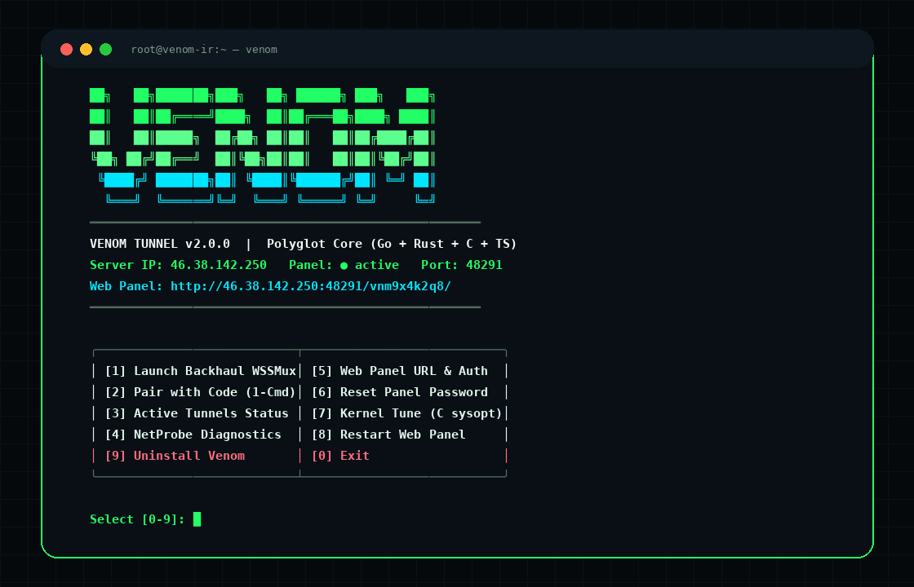
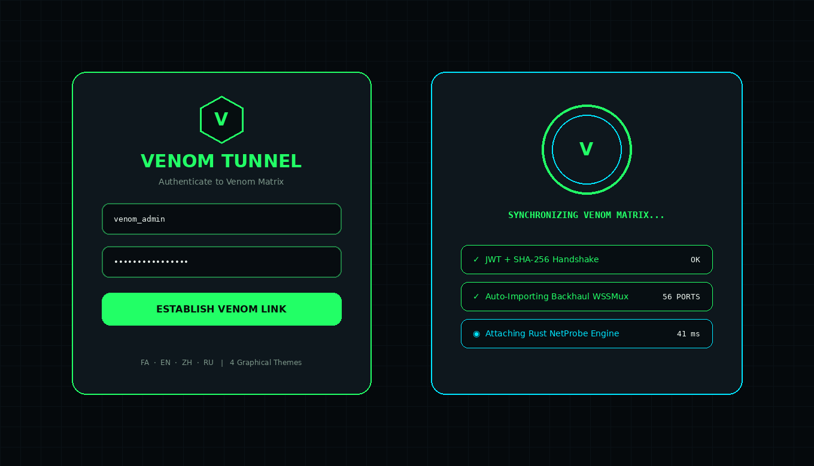
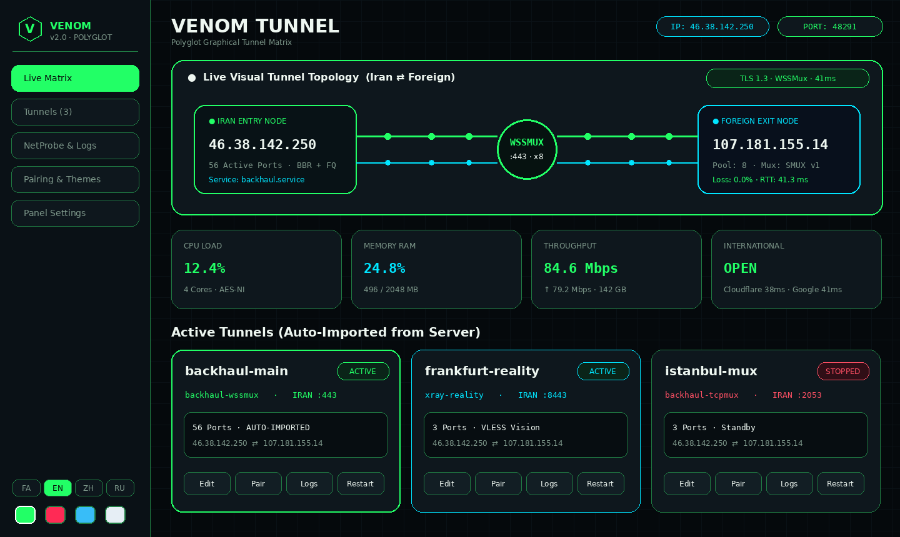
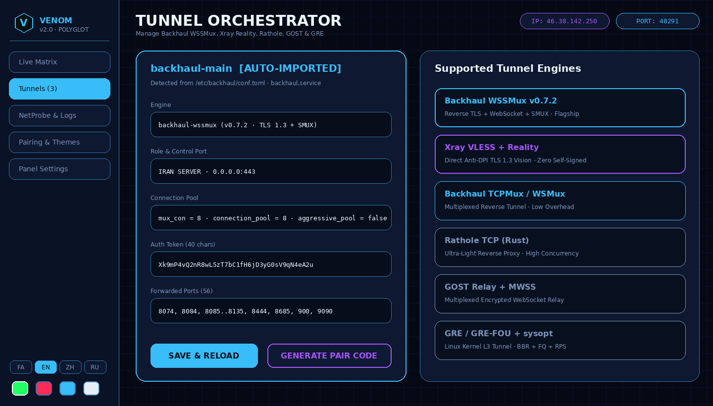
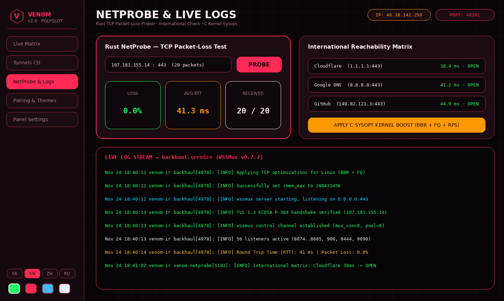
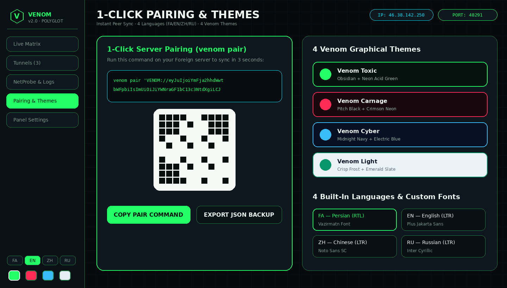

<div align="center">



<br/>

[](https://github.com/emdabsii/Venom-Tunnel/releases)
[](#architecture)
[](#engines)
[](LICENSE)

<h3>
  <a href="#persian-guide">🇮🇷 راهنمای کامل فارسی</a>
  &nbsp;&nbsp;•&nbsp;&nbsp;
  <a href="#english-guide">🇬🇧 Full English Guide</a>
</h3>

</div>

---

<a id="persian-guide"></a>
<div dir="rtl">

## 🇮🇷 راهنمای کامل فارسی — ونوم تانل (`VENOM TUNNEL v2.0`)

**ونوم تانل** یک پلتفرم گرافیکی، مدرن و چندزبانه (**Go + Rust + TypeScript/React + C + SQL + Bash**) برای ساخت، مدیریت، عیب‌یابی و مانیتورینگ تانل‌های پرسرعت بین سرور ایران و خارج است.

### ✨ ویژگی‌های کلیدی
- **وب‌پنل کاملاً گرافیکی و مدرن:** مجهز به صفحه‌ی اتصال انیمیشنی ونوم، **نقشه‌ی زنده‌ی توپولوژی (`ایران ⇄ خارج`)**، گیج‌های CPU/RAM/ترافیک و ترمینال لاگ زنده.
- **۴ زبان هم‌زمان با فونت اختصاصی:** فارسی (RTL با فونت `Vazirmatn`)، انگلیسی (`Plus Jakarta Sans`)، چینی (`Noto Sans SC`) و روسی (`Inter`) + فونت `JetBrains Mono` برای کدها و لاگ‌ها.
- **۴ تم گرافیکی اختصاصی ونوم:** `Venom Toxic` (سبز نئونی)، `Venom Carnage` (قرمز نئونی)، `Venom Cyber` (آبی سایبری) و `Venom Light`.
- **شناسایی خودکار تانل‌های فعلی (Auto-Import):** به محض نصب، تانل **`Backhaul v0.7.2 WSSMux`** فعلی (`/etc/backhaul/conf.toml`) و تانل‌های قبلی بدون کوچک‌ترین قطعی داخل وب‌پنل نمایش داده می‌شوند و قابل ویرایش هستند.
- **امنیت خودکار موقع نصب:** انتخاب خودکار یک **پورت ۵ رقمی تصادفی و آزاد**، ساخت مسیر مخفی (`Secret Path`) و تولید یوزرنیم و پسورد تصادفی قوی.
- **معماری ۶-زبانه بدون پایتون:** بک‌اند **Go**، موتور عیب‌یابی پکت‌لاس **Rust (`netprobe`)**، تیونینگ کرنل **C (`sysopt`)**، فرانت‌اند **TypeScript + React + Tailwind**، دیتابیس **SQLite WAL** و منوی ترمینال **Bash**.

---

### 🚀 ۱. نصب تک‌خطی (سرور ایران و خارج)

</div>

```bash
bash <(curl -Ls https://raw.githubusercontent.com/emdabsii/Venom-Tunnel/main/install.sh)
```

<div dir="rtl">

پس از اجرا، `install.sh` به‌صورت خودکار باینری‌ها و هسته‌ی **`Backhaul v0.7.2`** را نصب می‌کند، یک **پورت ۵ رقمی آزاد** انتخاب می‌کند و **لینک ورود، یوزرنیم و پسورد** وب‌پنل را در ترمینال چاپ می‌کند. برای باز کردن منوی ترمینال در هر زمان کافی است بزنید:

</div>

```bash
venom
```

<p align="center">
  
</p>

---

<div dir="rtl">

### 🔐 ۲. ورود به وب‌پنل و انیمیشن اتصال ونوم

لینک ۵ رقمی چاپ‌شده در ترمینال را در مرورگر باز کنید. پس از وارد کردن نام کاربری و رمز عبور، انیمیشن اتصال ونوم (بررسی JWT، شناسایی خودکار تانل‌های فعال و اتصال به موتور Rust NetProbe) اجرا می‌شود.

</div>

<p align="center">
  
</p>

---

<div dir="rtl">

### ◈ ۳. داشبورد گرافیکی و نقشه‌ی زنده توپولوژی

در صفحه اول پنل، وضعیت اتصال `سرور ایران ⇄ سرور خارج` به‌صورت گرافیکی با پینگ زنده (`RTT`)، درصد پکت‌لاس، وضعیت باز بودن دسترسی بین‌الملل و مصرف منابع نمایش داده می‌شود.

</div>

<p align="center">
  
</p>

---

<div dir="rtl">

### ⬡ ۴. مدیریت و ویرایش تانل‌ها (شناسایی خودکار `Backhaul WSSMux`)

تانل **`Backhaul WSSMux v0.7.2`** فعلی شما به‌صورت خودکار با برچسب `AUTO-IMPORTED` در پنل ظاهر می‌شود و می‌توانید پورت‌ها، توکن (اعتبارسنجی ۲۰ تا ۶۴ کاراکتر)، پورت کنترل و موتور تانل را بدون قطعی ویرایش یا ری‌استارت کنید.

</div>

<p align="center">
  
</p>

---

<div dir="rtl">

### ⚡ ۵. عیب‌یابی شبکه (`Rust NetProbe`)، بهینه‌ساز کرنل (`C sysopt`) و لاگ زنده

از داخل پنل می‌توانید پکت‌لاس TCP بین دو سرور را با موتور **Rust** اندازه بگیرید، باز بودن دسترسی بین‌الملل (`Cloudflare / Google / GitHub`) را چک کنید، با یک کلیک **`BBR + FQ + RPS`** را با ماژول **C** فعال کنید و لاگ زنده تانل را ببینید.

</div>

<p align="center">
  
</p>

---

<div dir="rtl">

### ∞ ۶. جفت‌سازی یک‌کلیکه (`venom pair`)، ۴ تم و ۴ زبان

برای وصل کردن سرور دوم، کافی است دستور جفت‌سازی تولیدشده در پنل را روی سرور مقابل اجرا کنید تا در ۳ ثانیه تانل دوطرفه آماده شود. همچنین از همین بخش می‌توانید بین ۴ تم گرافیکی ونوم و ۴ زبان سوییچ کنید.

</div>

<p align="center">
  
</p>

---

<div dir="rtl">

### 🛠️ دستورات سریع ترمینال (ویرایش، ریست رمز و حذف کامل)

</div>

```bash
venom                # باز کردن منوی گرافیکی ترمینال
venom panel          # نمایش لینک پورت ۵ رقمی و یوزرنیم پنل
venom reset-auth     # ساخت رمز عبور جدید و ری‌استارت پنل
venom status         # وضعیت همه تانل‌های فعال
venom optimize       # اجرای بهینه‌ساز کرنل C (BBR + FQ + RPS)
venom pair 'VENOM://...'  # جفت‌سازی خودکار با سرور مقابل
venom uninstall      # حذف کامل و تمیز ونوم (بدون حذف تانل‌های /etc/backhaul)
```

---

<a id="english-guide"></a>

## 🇬🇧 English Guide — `VENOM TUNNEL v2.0`

**Venom Tunnel** is a modern, polyglot (**Go + Rust + TypeScript/React + C + SQL + Bash**) tunnel orchestrator and graphical web control matrix built for high-stability reverse and anti-DPI tunneling.

<a id="architecture"></a>
### Polyglot Architecture

| Layer | Language | Role |
| :--- | :--- | :--- |
| **Core Server & Orchestrator** | **Go 1.22** | Zero-dependency HTTP/API server, JWT + SHA-256 auth, systemd controller, auto-importer for `/etc/backhaul/conf.toml` |
| **Network Telemetry & Prober** | **Rust** | `venom-netprobe` — TCP packet-loss prober, RTT/jitter measurement, international reachability matrix, `/proc` telemetry |
| **Graphical Web Panel** | **TypeScript + React + Tailwind** | Embedded SPA (`//go:embed`) with 4 languages (`FA / EN / ZH / RU`), 4 Venom themes, splash sequence & live SVG topology |
| **Kernel Optimizer** | **C** | `venom-sysopt` — Direct kernel tuning (`BBR`, `fq`, 64MB buffers, `nf_conntrack_max=1M`, multi-core `RPS`) |
| **Persistence** | **SQL (SQLite WAL)** | Relational schema for tunnels, metrics history, audit logs, and panel settings |
| **CLI & CI/CD** | **Bash + GitHub Actions** | Interactive `venom` neon CLI, one-line `install.sh`, and automated `amd64`/`arm64` release builds |

<a id="engines"></a>
### Supported Tunnel Engines
- **Reverse Tunnels (Recommended for Iran Datacenters):** `Backhaul v0.7.2` (`wssmux`, `wsmux`, `tcpmux`, `tcp`, `udp`), `Rathole TCP`, `FRP`
- **Direct Anti-DPI Tunnels:** `Xray VLESS + Reality + Vision`, `GOST Relay + MWSS`
- **Kernel Tunnels:** `GRE`, `GRE over FOU`, `WireGuard`

### Quick Install / Update / Uninstall

```bash
# 1. One-line install (auto-assigns random free 5-digit port & credentials)
bash <(curl -Ls https://raw.githubusercontent.com/emdabsii/Venom-Tunnel/main/install.sh)

# 2. Launch interactive CLI
venom

# 3. Pair peer server in 3 seconds
venom pair 'VENOM://...'

# 4. Reset panel password
venom reset-auth

# 5. Clean uninstall
venom uninstall
```

### Build From Source (All 6 Languages)

```bash
git clone https://github.com/emdabsii/Venom-Tunnel.git
cd Venom-Tunnel
make all
sudo bash install.sh
```

> **Tip for GitHub Publishing:** Replace `emdabsii` in `install.sh` and `README.md` with your GitHub username, push the repo, and create a tag (`git tag v2.0.0 && git push origin v2.0.0`) — GitHub Actions (`.github/workflows/release.yml`) will automatically compile and publish `linux/amd64` and `linux/arm64` binaries for you!
